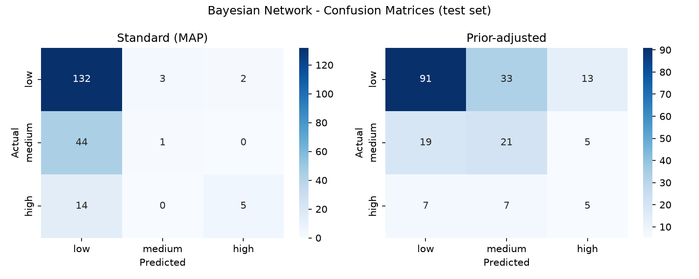
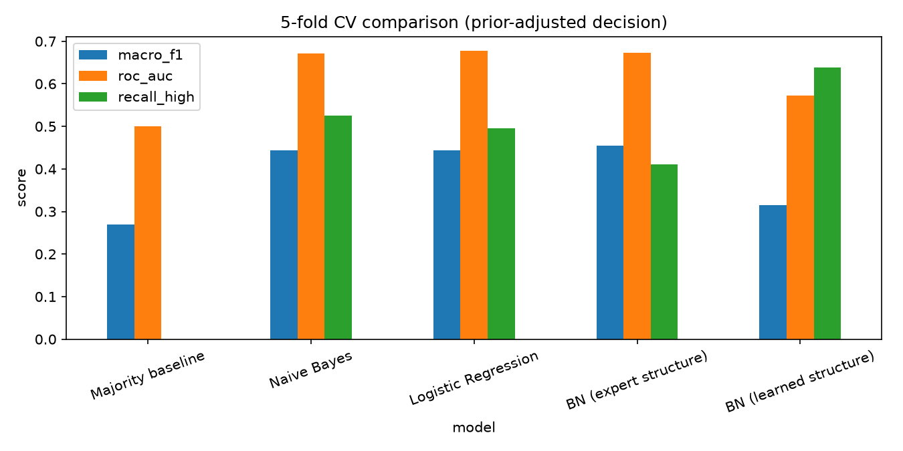
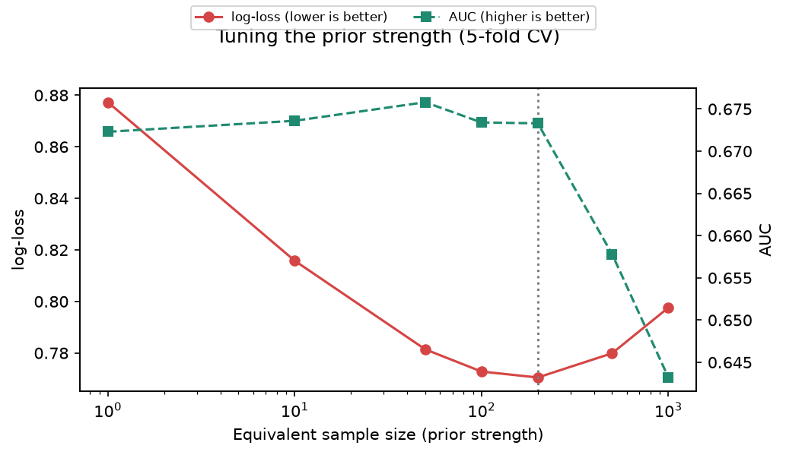
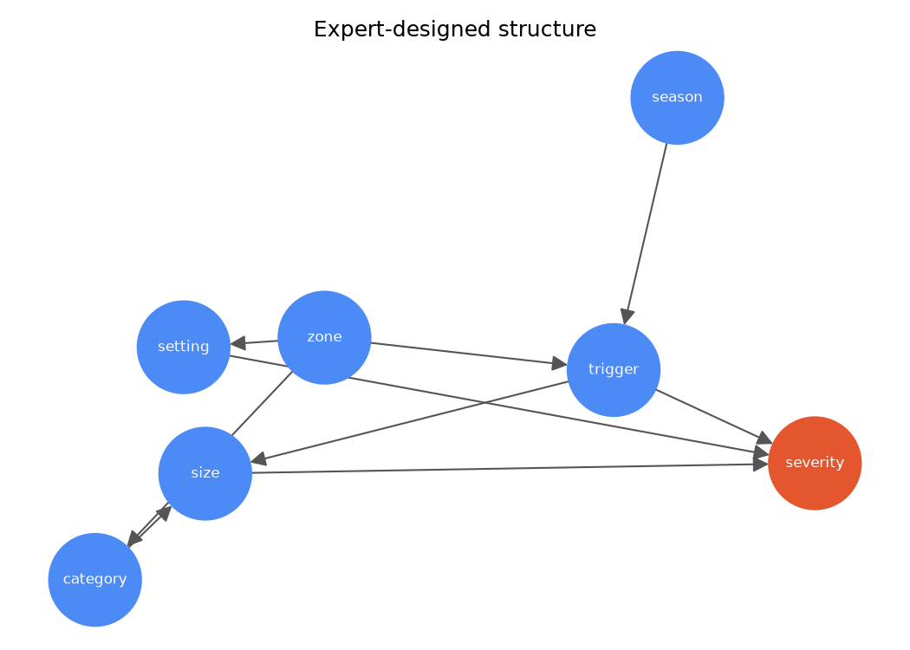
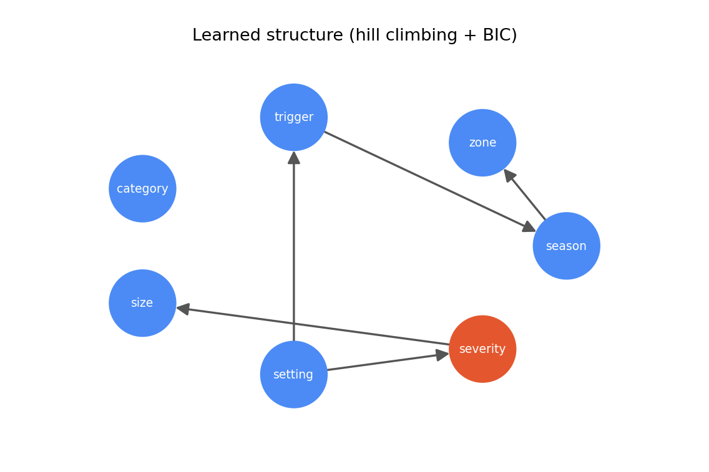

# Landslide Risk Assessment in India Using Bayesian Network Inference

Mini-project | Department of CSE (AI&ML), RYMEC Ballari | Academic Year 2025-26

**Live demo:** https://landslide-bayesian-network.streamlit.app/
**Source code:** https://github.com/gkchandu/landslide-bayesian-network

## Problem Statement
Landslides are among the most destructive natural hazards in India. Heavy monsoon rainfall, steep terrain in the
Himalaya, the Northeast and the Western Ghats, and human activity such as road cutting and construction regularly
trigger slope failures that kill people, block roads and destroy homes. Whether a landslide turns deadly depends on
several uncertain, interacting factors (what triggered it, how large it was, where and when it happened), and the
information available in the field is often incomplete.

This matters for the public and for disaster-management authorities, who must decide where to focus warnings,
inspections and relief with limited information. A single yes/no prediction is not enough for that. This project
uses a Bayesian Network to estimate the full probability of low, medium and high severity from whatever
conditions are known, and to reason in both directions, for example, "what trigger is most likely behind a
high-fatality event?"

## Objectives
- To build a Bayesian Network on historical Indian landslide records and learn its conditional probability tables
- To analyze how season, region, trigger, landslide type, size and setting influence the severity of an event
- To evaluate the model with train/test and 5-fold cross-validation and compare it with Naive Bayes, Logistic Regression and a learned network structure
- To design a Streamlit web application for risk prediction, batch file analysis and free-form probabilistic queries

## Expected Outcomes
- Predict the probability of low / medium / high severity for a described landslide situation, or report that the data cannot say ("uncertain") when a combination has never been observed
- Analyze a CSV file of many events at once and download the results
- Answer what-if and diagnostic questions, such as which trigger is likely given a high-severity event
- Show model performance, confusion matrices and network structures in the app

## Dataset
- **Source:** NASA Global Landslide Catalog (Open Data Portal, one-time export current to 2016)
- **Records:** 11,033 worldwide; 1,265 for India; **1,004** usable after removing events with no fatality count
- **Variables:** season (from event date), zone (from coordinates), trigger, landslide category, size, setting
- **Target:** severity, derived from fatality count: **low** = 0 (683 events), **medium** = 1-4 (224), **high** = 5 or more (97)

**Preprocessing** (`preprocess.py`): filter to India; parse dates and drop rows with invalid coordinates; remove
duplicates; drop rows without a fatality count; fill missing categorical values with "unknown"; convert month to
an Indian season (winter, pre-monsoon, monsoon, post-monsoon); derive four approximate regions from latitude and
longitude; merge rare categories into "other"; integer-encode a copy for the baseline models; rank features by
mutual information and chi-square against severity. Continuous values are discretized, so no normalization is
needed for a discrete Bayesian Network.

## Methodology
1. **Network structure:** an expert-designed directed graph (region and season influence trigger; region influences type and setting; trigger and type influence size; size, trigger and setting influence severity). A second structure was learned from data with hill climbing and the BIC score for comparison.
2. **Parameter learning:** conditional probability tables estimated with a BDeu prior (`pgmpy`). Severity has 96 parent combinations but only about 1,000 records, so the prior strength (equivalent sample size, ESS) was **tuned by 5-fold cross-validation** on log-loss. ESS = 100 was chosen; the minimum was at 200, but 100 was within 0.003 and kept a slightly better balanced F1.
3. **Inference:** Variable Elimination, which works with any subset of known evidence and in any direction.
4. **Decision rules:** a standard rule (most probable class) and a prior-adjusted rule that divides each probability by its class base rate, so rarer medium and high severities are not drowned out by "low". When a combination of evidence has never been observed, all outcomes are equally likely, and the app reports "uncertain" instead of a class.
5. **Evaluation:** stratified 80/20 hold-out test, 5-fold cross-validation, and baselines (majority class, Naive Bayes, Logistic Regression).

## Results
Always predicting "low" gives 68% accuracy, so accuracy alone is misleading; macro-F1, recall for high severity
and AUC are reported as well.

**Hold-out test (803 train / 201 test):**

| Decision rule | Accuracy | Macro precision | Macro recall | Macro F1 | AUC |
|---|---|---|---|---|---|
| Standard | 0.687 | 0.553 | 0.416 | 0.411 | 0.661 |
| Prior-adjusted | 0.582 | 0.447 | 0.465 | 0.450 | 0.661 |
| Prior-adjusted, `size` unknown | 0.304 | 0.464 | 0.450 | 0.300 | 0.628 |

**5-fold cross-validation (mean of 5 folds):**

| Model | Rule | Accuracy | Macro F1 | Recall (high) | AUC |
|---|---|---|---|---|---|
| Majority baseline | both | 0.680 | 0.270 | 0.000 | 0.500 |
| Naive Bayes | standard | 0.680 | 0.395 | 0.174 | 0.671 |
| Naive Bayes | prior-adjusted | 0.537 | 0.443 | 0.525 | 0.671 |
| Logistic Regression | standard | 0.688 | 0.395 | 0.205 | 0.678 |
| Logistic Regression | prior-adjusted | 0.533 | 0.443 | 0.495 | 0.678 |
| **Bayesian Network (expert)** | standard | **0.699** | **0.446** | 0.349 | 0.673 |
| **Bayesian Network (expert)** | prior-adjusted | 0.567 | 0.455 | 0.411 | 0.673 |
| Bayesian Network (learned) | standard | 0.681 | 0.355 | 0.196 | 0.578 |
| Bayesian Network (learned) | prior-adjusted | 0.420 | 0.321 | 0.512 | 0.578 |

Fold-to-fold standard deviation of macro-F1 is about 0.02 to 0.05 for most models (about 0.10 for the learned
structure under the prior-adjusted rule), so small gaps between models are not conclusive.

**Prior strength tuning (5-fold CV, expert network):**

| ESS | 1 | 10 | 50 | 100 | 200 | 500 | 1000 |
|---|---|---|---|---|---|---|---|
| Log-loss (lower is better) | 0.877 | 0.816 | 0.781 | 0.773 | **0.771** | 0.780 | 0.798 |
| AUC | 0.672 | 0.674 | 0.676 | 0.673 | 0.673 | 0.658 | 0.643 |

Stronger smoothing improves the quality of the probabilities (log-loss falls from 0.816 at ESS 10 to 0.773 at
ESS 100) without changing standard accuracy or macro-F1. It also prevents single events from dominating a
probability table: before tuning, one recorded event gave 94% for its class.

**Interpretation**
- The expert Bayesian Network has the best accuracy and macro-F1 under the standard rule and detects more high-severity events than the baselines. Its AUC is essentially tied with Naive Bayes and Logistic Regression, so it is competitive and far more interpretable rather than clearly more accurate.
- The structure learned from data performed worse (AUC 0.578) and varied widely between folds. With about 1,000 records BIC is conservative, and it produced non-causal links (such as season to zone), which supports using domain knowledge for the structure.
- Landslide **size** is the strongest single driver of severity. Example inference: for a large landslide triggered by a downpour in the monsoon, the network gives about 42% probability of high severity (34% low, 24% medium), against roughly 10% for an average event.
- Diagnostic query, P(trigger | high severity): rain (20%) and the merged rare "other" triggers (14%) are over-represented among high-severity events compared with their overall shares (about 15% and 4%), while downpour (41%) and continuous rain (10%) appear less often than in the data overall (about 54% and 17%).
- Slopes above roads in the western Himalaya are mostly low severity (about 80% low, 14% medium, 6% high).
- With `size` unknown, the prior-adjusted rule catches most high-severity events but raises many false alarms, which is the expected cost of missing information.

<!-- Add your screenshots here, for example: -->
<!--  -->







## Project Structure
```
├── app.py              # Streamlit web app
├── preprocess.py       # cleaning, discretization, encoding, feature scoring
├── train_model.py      # Bayesian Network training and hold-out evaluation
├── evaluate.py         # cross-validation, baselines, structure learning
├── tune_ess.py         # prior-strength tuning by cross-validation
├── draw_networks.py    # regenerates the network diagrams
├── data/               # cleaned dataset and feature scores
├── model/              # trained model, metrics, figures
├── .streamlit/         # app theme
├── requirements.txt
└── README.md
```

## How to Run Locally
```bash
git clone https://github.com/gkchandu/landslide-bayesian-network.git
cd landslide-bayesian-network
python -m venv venv
venv\Scripts\activate           # Mac/Linux: source venv/bin/activate
pip install -r requirements.txt
# download the NASA Global Landslide Catalog CSV into data/raw/Global_Landslide_Catalog_Export.csv
python preprocess.py
python train_model.py
python tune_ess.py              # optional: re-tune the prior strength
python evaluate.py
streamlit run app.py
```

## Limitations
- The catalog is a 2016 export built mostly from media reports, so it is biased toward well-covered events and mostly contains rain-triggered landslides.
- It has no population exposure, time of day, terrain or rainfall measurements, which strongly affect fatalities, so predictive power is modest (AUC about 0.67).
- Regions are approximated from coordinates, and 1,004 records leave few examples of high-severity events (97).
- Some combinations of size, trigger and setting never occur in the data, so their probability tables rest on the prior alone; the app reports these as "uncertain". This can also add false alarms under the prior-adjusted rule.
- The prior strength was tuned on the same folds later used to report cross-validation results, so those figures may be slightly optimistic.
- This is an academic prototype and must not be used for real safety decisions.

## Future Scope
- Use NASA's **COOLR** repository for newer and larger records beyond 2016
- Add rainfall (GPM IMERG, CHIRPS), terrain (SRTM) and land cover as network variables, and pseudo-absence points to estimate landslide occurrence
- Dynamic Bayesian Network for rainfall build-up and early warning, and a decision network for actions such as road closure or evacuation
- District-level risk map using population exposure data

## References
- NASA Global Landslide Catalog, NASA Open Data Portal
- Kirschbaum, D., Stanley, T., Zhou, Y. (2015). Spatial and temporal analysis of a global landslide catalog. *Geomorphology*, 249
- Ankan, A., Panda, A. pgmpy: Probabilistic Graphical Models using Python
- Streamlit documentation, https://docs.streamlit.io
